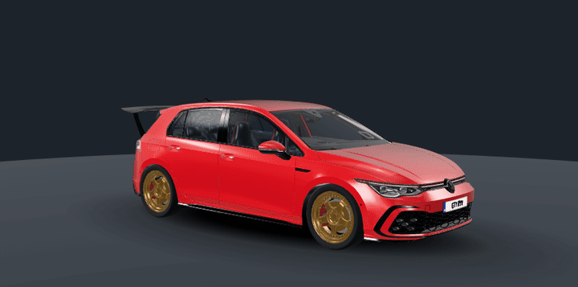
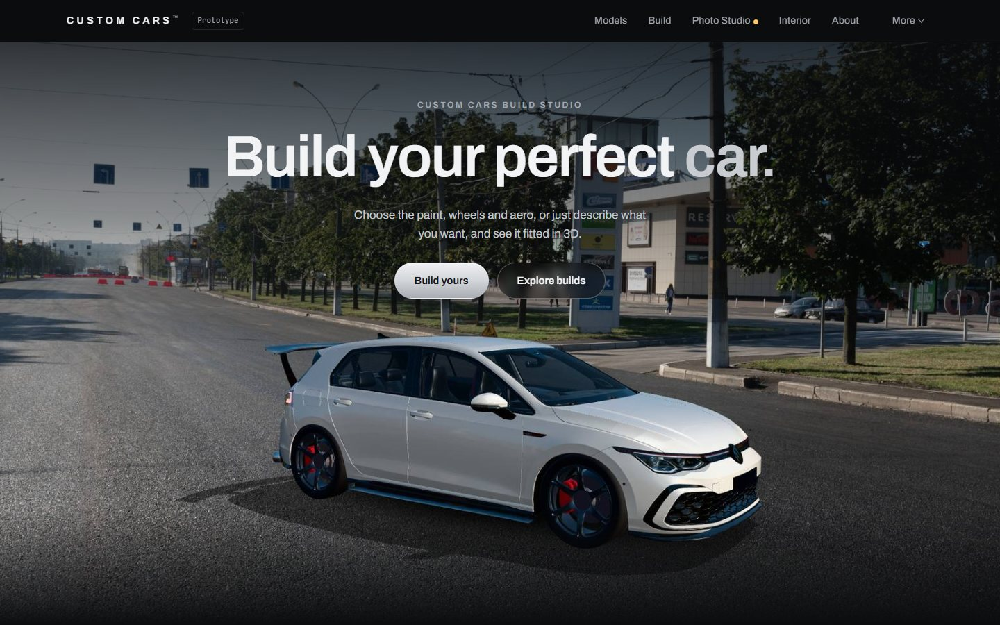
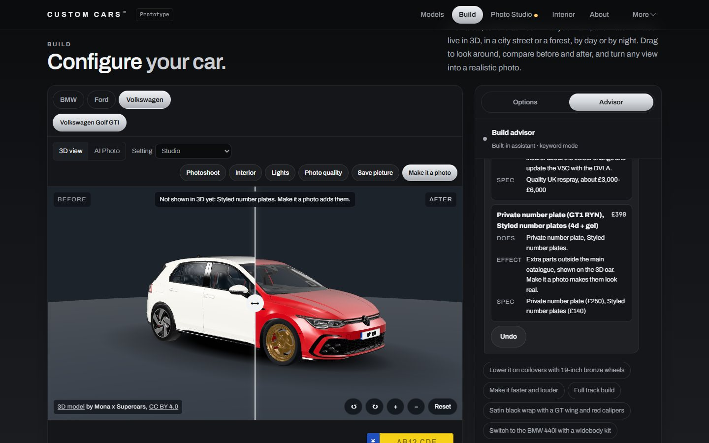
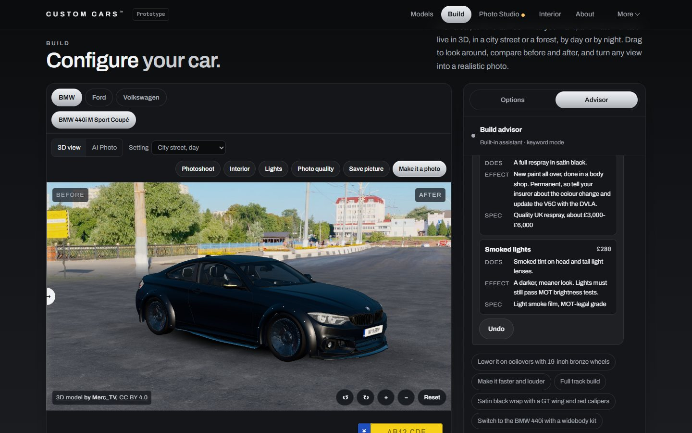
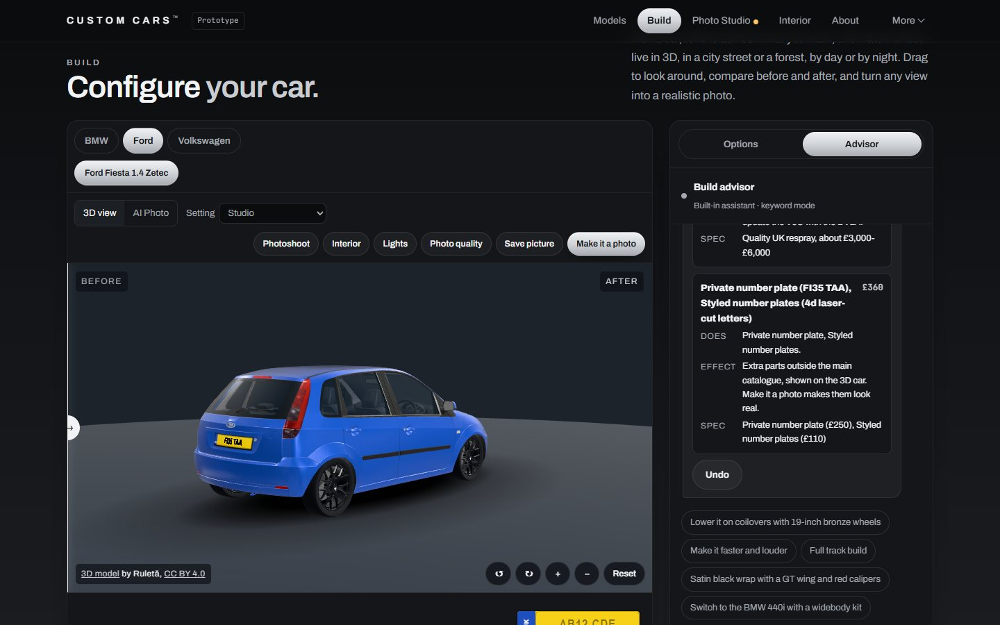
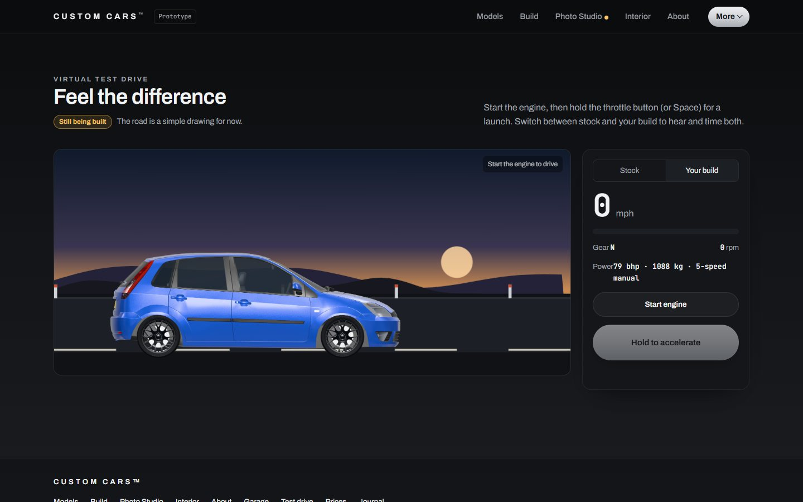
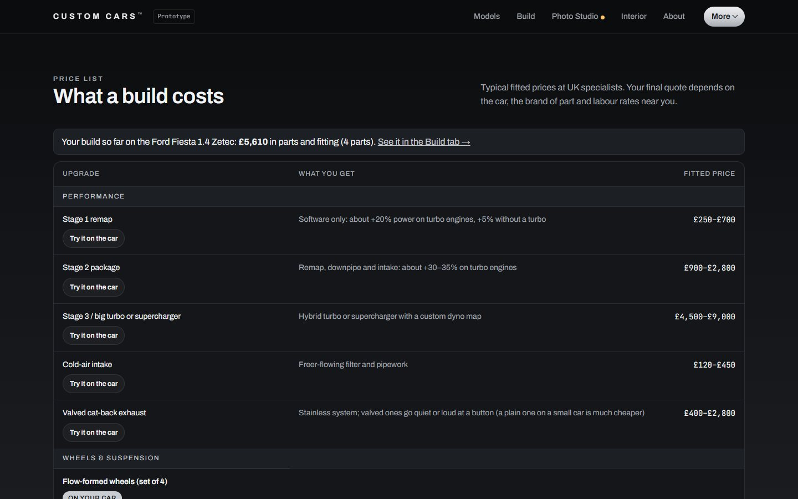

# Custom Cars (HTML, JavaScript, three.js and Python)

A UK car customisation website I built using different AI models through Claude. I've always been into cars and modifying them, so I wanted to see if I could build a site where you can plan your own build, see it fitted on the car in 3D, and know roughly what it would cost before you spend anything.

You pick a car, choose your mods (or just type what you want in plain English) and the car updates live in 3D. It's still being built and it updates on here constantly, so there's always something new being added or fixed.

---

## What It Looks Like



A Golf GTI I built just by typing "gloss red paint, lower it 35mm with 19 inch bronze deep dish wheels, rear wing and a 4d gel plate saying GT1 RYN" into the advisor.

| | |
|---|---|
|  |  |
| **Home page** | **Telling the advisor what I want (before and after)** |
|  |  |
| **BMW 440i widebody on a city street** | **Fiesta with my own 4D number plate** |
|  |  |
| **Virtual test drive** | **UK fitted prices** |

These are straight from the site running on my laptop. The full 3D car models aren't in this repository though, because I couldn't confirm where they originally came from (more on that below).

---

## What It Does

- Lets you build your car in 3D: paint and wraps, wheels, lowering, spoilers, body kits, widebody, brakes, lights, tints and loads more
- Has an AI build advisor you can just talk to, like "lower it 30mm with 19 inch bronze wheels"
- Shows real UK figures: power, torque and 0-62 for the standard car and after your mods
- Gives you typical UK fitted prices for every part and a running total for your build
- Lets you sit inside the car and look around the interior
- Has number plates you can customise: your own reg, 3D gel or 4D letters, different shapes, borders and badges
- Turns your build into a realistic AI photo
- Has a virtual test drive where you can hear the engine and time a 0-62 launch
- Sorts every car by brand, so more cars can keep being added

It's a full website that runs on your own computer, with the 3D, the advisor and the prices all working together.

---

## Why I Made It

To be honest, I wanted to push myself way past the small Python projects I've done so far and see how far I could get with a proper website. I wanted to:

- Build something real that I'd actually use myself
- Learn how 3D works in a web browser (three.js)
- Work with AI properly, both for building the site and inside it (the advisor and the AI photos)
- Get used to working on a big project that keeps growing every day

It taught me a lot about how websites are put together, how 3D models work and how to plan a project that keeps changing.

---

## How It's Laid Out

```
Custom_Cars/
│
├─ index.html        # The website itself (every page lives in here)
├─ start.bat         # Double-click this to run the site on Windows
├─ .env.example      # Settings template for the AI photos (copy it to .env)
├─ css/              # How everything looks
├─ js/               # How everything works
│  ├─ advisor/       # The AI build advisor that understands what you type
│  ├─ data/          # The cars, parts, UK prices and journal articles
│  ├─ three/         # The 3D car, parts, badges and number plates
│  └─ photo/         # Turning your build into an AI photo
├─ server/           # A small Python server that runs the site and the AI photos
├─ models/           # Settings for each car's 3D model, and the tools that prepare them
├─ env/              # Scripts that download the 3D backgrounds (free, from Poly Haven)
├─ tools/            # Helper scripts (like the one that publishes this repository)
└─ docs/             # The detailed developer notes
```

Each folder does its own thing, and together they make the whole site work.

---

## How To Use It

1. **Download my files off GitHub**
   - Click the green Code button, then Download ZIP
   - Unzip it somewhere on your computer

2. **Make sure you've got Python**
   - You'll need Python 3 installed (python.org)
   - There's nothing else to install, the server only uses Python's built-in parts

3. **Run the site**
   - Double-click `start.bat` (on Windows)
   - Or open a terminal in the folder and run:
     ```bash
     python server/app.py
     ```
   - Your browser should open the site at http://127.0.0.1:8000
   - Keep the black window open while you're using it

4. **Build your car**
   - Go to the Build tab
   - Pick a brand and a car
   - Choose your mods in Options, or tell the Advisor what you want

5. **See real parts (optional, free)**
   - Step 3 of the Build page can show a real eBay listing for every part, with its photo, price and link
   - It needs free eBay developer keys in your `.env` file. The steps are in `docs/EBAY.md`

6. **Make it a photo (optional)**
   - The AI photos work for free by copying an instruction into the Gemini app
   - If you want them to be automatic, copy `.env.example` to `.env` and add your own Google API key (Google charges for this, so be careful)

---

## If Something Goes Wrong

Problem -> Solution:

```python is not recognised``` -> Install Python from python.org and tick "Add to PATH", or try ```py server/app.py```

```The page won't load``` -> Make sure the black window from start.bat is still open

```The car is just a simple shape``` -> The full 3D car models aren't on GitHub (see below), so the site shows a stand-in shape instead

```The backgrounds are missing``` -> Run ```python env/get_hdris.py``` to download them (they're free)

---

## One Important Thing

The full 3D car models aren't included in this repository. Some of them came from sites where I couldn't fully confirm where they originally came from, so I've kept them on my own computer only and they're not shared here. The site still works without them, it just uses simple stand-in shapes for the cars.

Also, please don't share your own `.env` file or API key with anyone:

- Don't upload .env to GitHub (it's already ignored, so it won't upload by accident)
- If you ever leak your key, delete it and make a new one straight away

---

## Stuff I Might Add Later

- Loads more cars and brands
- A proper 3D road for the test drive
- More ready-made builds for every car
- A way to save and share your builds with other people
- Putting the site online so anyone can use it

There's no doubt about it that this one is going to keep growing, and I'd love to keep taking it further.

---

## Final Thoughts

This is by far the biggest project I've worked on and it's been genuinely fun to build. Anyone who is looking at my work, thank you for taking your time to check it out. Please leave me any feedback or ideas, since I'm always attempting to learn more!

_Built with help from Claude (Anthropic's AI). 3D engine: three.js. Backgrounds: Poly Haven (CC0). 3D car models in the pictures (not included here): Volkswagen Golf 8 GTI by Mona x Supercars, BMW 4 Series F32 by Merc_TV and Ford Fiesta Mk5 by Ruletă, all listed on Sketchfab as CC BY 4.0. Car names and figures belong to their manufacturers and are only used to identify the cars; this project isn't linked to any manufacturer._
